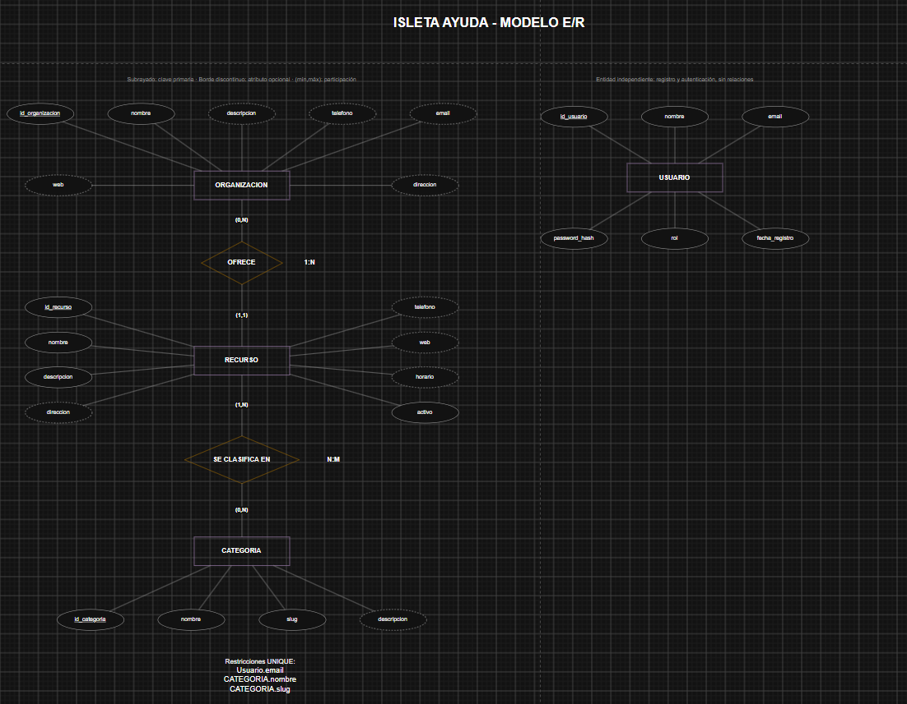
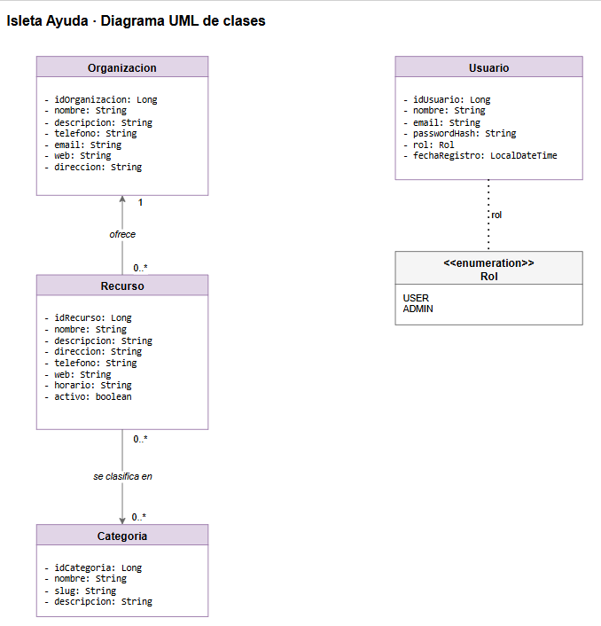
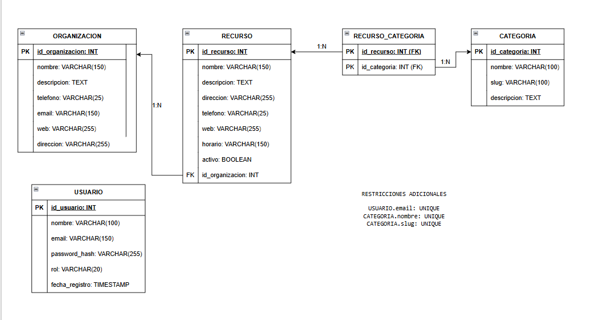
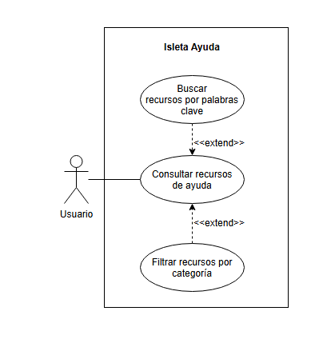

# Isleta Ayuda — Backend

## 1. Descripción del proyecto

**Isleta Ayuda** es una aplicación destinada a facilitar el acceso a recursos de ayuda social, empleo y formación para personas vulnerables, especialmente en el barrio de La Isleta, en Las Palmas de Gran Canaria.

El proyecto está dividido en dos partes:

- **Frontend:** desarrollado con React y Vite. Permite consultar recursos, buscar por palabras clave, filtrar por categorías y utilizar las funciones de registro e inicio de sesión.
- **Backend:** desarrollado con Java y Spring Boot. Expone una API REST para comunicar la aplicación con la base de datos MariaDB.

En el backend se utiliza **JPA** para representar las tablas de la base de datos mediante clases Java y gestionar las relaciones entre ellas.

### Repositorios

- **Frontend:** https://github.com/Erik2007-bot/isleta-ayuda-web
- **Backend:** https://github.com/Erik2007-bot/isleta-ayuda-backend

## 2. Funcionalidades implementadas

- Consulta de recursos de ayuda almacenados en MariaDB.
- Búsqueda de recursos por palabras clave.
- Filtrado de recursos por categorías.
- Visualización de la organización asociada a cada recurso.
- Registro e inicio de sesión de usuarios mediante JWT.
- Protección de las funcionalidades que requieren autenticación.
- Mensajes de carga, ausencia de resultados y errores de conexión.

**Nota:** la búsqueda por palabras clave y el filtrado por categoría se realizan en el frontend React sobre los recursos obtenidos del backend.

## 3. Modelo de datos

La base de datos de Isleta Ayuda está desarrollada con MariaDB. Su estructura permite almacenar recursos de ayuda, las organizaciones que los ofrecen, sus categorías y los usuarios registrados.

El modelo se ha diseñado mediante tres diagramas: Entidad-Relación, UML de clases y relacional.

### 3.1. Diagrama Entidad-Relación (E/R)

Este diagrama representa las entidades del sistema, sus atributos y las relaciones existentes.

Las entidades principales son:

- **Usuario:** almacena los datos de las personas registradas.
- **Organizacion:** contiene la información de las entidades que ofrecen ayuda.
- **Recurso:** representa los servicios y oportunidades disponibles.
- **Categoria:** permite clasificar los recursos según el tipo de ayuda.

### 3.2. Diagrama UML de clases

El diagrama UML representa las clases del dominio, sus atributos y sus asociaciones.

Se han definido las siguientes relaciones:

- **Organizacion — Recurso (1:N):** cada recurso pertenece obligatoriamente a una organización, mientras que una organización puede ofrecer cero o varios recursos.
- **Recurso — Categoria (N:M):** un recurso puede pertenecer a cero o varias categorías y una categoría puede estar asociada a cero o varios recursos.
- **Usuario:** entidad independiente utilizada para el registro y la autenticación. Su atributo `rol` utiliza la enumeración `Rol`, con los valores `USER` y `ADMIN`.

### 3.3. Modelo relacional

El modelo relacional transforma las entidades y asociaciones en tablas de MariaDB.

Las tablas principales son `usuario`, `organizacion`, `recurso` y `categoria`.

La relación muchos a muchos entre recursos y categorías se resuelve mediante la tabla intermedia `recurso_categoria`, que contiene:

- `id_recurso`: clave foránea que referencia a `recurso`.
- `id_categoria`: clave foránea que referencia a `categoria`.

Ambas columnas forman una clave primaria compuesta, evitando duplicar la misma asociación entre un recurso y una categoría.

La tabla `recurso` también contiene `id_organizacion` como clave foránea, que permite relacionar cada recurso con su organización.

### 3.4. Restricciones y claves

Las claves primarias identifican de forma única cada registro, mientras que las claves foráneas mantienen las relaciones entre las tablas.

Además, el modelo contempla restricciones de unicidad para el correo electrónico de los usuarios, el nombre de las categorías y su identificador textual `slug`.

Estas restricciones ayudan a evitar duplicidades y mantener la integridad de los datos.

### 3.5. Diccionario de datos

El siguiente diccionario describe los campos de las tablas de Isleta Ayuda, tomando como referencia el modelo relacional.

**Tabla `organizacion`**

| Campo | Tipo | Descripción |
|---|---|---|
| `id_organizacion` | INT | Clave primaria (PK). |
| `nombre` | VARCHAR(150) | Nombre de la organización. |
| `descripcion` | TEXT | Descripción de la organización. |
| `telefono` | VARCHAR(25) | Teléfono de contacto. |
| `email` | VARCHAR(150) | Correo electrónico. |
| `web` | VARCHAR(255) | Página web. |
| `direccion` | VARCHAR(255) | Dirección de la organización. |

**Tabla `recurso`**

| Campo | Tipo | Descripción |
|---|---|---|
| `id_recurso` | INT | Clave primaria (PK). |
| `nombre` | VARCHAR(150) | Nombre del recurso. |
| `descripcion` | TEXT | Descripción del recurso. |
| `direccion` | VARCHAR(255) | Lugar donde se ofrece. |
| `telefono` | VARCHAR(25) | Teléfono de contacto. |
| `web` | VARCHAR(255) | Página web del recurso. |
| `horario` | VARCHAR(150) | Horario de atención. |
| `activo` | BOOLEAN | Indica si el recurso está activo. |
| `id_organizacion` | INT | Clave foránea (FK) hacia `organizacion`. |

**Tabla `categoria`**

| Campo | Tipo | Descripción |
|---|---|---|
| `id_categoria` | INT | Clave primaria (PK). |
| `nombre` | VARCHAR(100) | Nombre de la categoría. |
| `slug` | VARCHAR(100) | Identificador textual de la categoría. |
| `descripcion` | TEXT | Descripción de la categoría. |

**Tabla `usuario`**

| Campo | Tipo | Descripción |
|---|---|---|
| `id_usuario` | INT | Clave primaria (PK). |
| `nombre` | VARCHAR(100) | Nombre del usuario. |
| `email` | VARCHAR(150) | Correo electrónico único. |
| `password_hash` | VARCHAR(255) | Contraseña almacenada mediante hash. |
| `rol` | VARCHAR(20) | Rol del usuario (`USER` o `ADMIN`). |
| `fecha_registro` | TIMESTAMP | Fecha y hora del registro. |

**Tabla `recurso_categoria`**

| Campo | Tipo | Descripción |
|---|---|---|
| `id_recurso` | INT | FK hacia `recurso`. |
| `id_categoria` | INT | FK hacia `categoria`. |

La tabla `recurso_categoria` utiliza una clave primaria compuesta por `id_recurso` e `id_categoria`. Su función es representar la relación muchos a muchos entre los recursos y las categorías.

## 4. Mapeo objeto-relacional (ORM)

El backend de Isleta Ayuda utiliza **Spring Data JPA** para trabajar con los datos almacenados en MariaDB mediante clases Java.

El ORM permite relacionar los objetos de la aplicación con las tablas de la base de datos. En este proyecto, las clases de entidad representan las tablas del modelo relacional.

### 4.1. Entidades JPA

Las entidades principales del proyecto son:

| Clase Java | Tabla de MariaDB | Función |
|---|---|---|
| `Usuario` | `usuario` | Almacenar los usuarios registrados y sus datos de autenticación. |
| `Organizacion` | `organizacion` | Representar las entidades que ofrecen recursos de ayuda. |
| `Recurso` | `recurso` | Almacenar los recursos de ayuda disponibles. |
| `Categoria` | `categoria` | Clasificar los recursos según el tipo de ayuda. |

Las entidades utilizan anotaciones como `@Entity`, `@Table`, `@Id` y `@Column` para definir su correspondencia con las tablas y columnas.

### 4.2. Relación entre Recurso y Organizacion

En `Recurso.java` se utiliza `@ManyToOne` para indicar que varios recursos pueden pertenecer a una misma organización.

La anotación `@JoinColumn(name = "id_organizacion")` identifica la clave foránea que conecta ambas tablas.

Además, la relación está marcada como obligatoria mediante `optional = false` y `nullable = false`.

### 4.3. Relación entre Recurso y Categoria

La relación entre recursos y categorías se implementa mediante `@ManyToMany`.

Un recurso puede estar asociado a varias categorías y una categoría puede estar relacionada con varios recursos.

JPA utiliza `@JoinTable` para definir la tabla intermedia `recurso_categoria`, formada por dos claves foráneas: `id_recurso` e `id_categoria`.

La colección de categorías se representa con `Set<Categoria>`, lo que permite gestionar las asociaciones sin repetir elementos dentro de la colección.

En el mapeo actual no se exige que un recurso tenga al menos una categoría, por lo que la relación se representa como `0..*` en ambos extremos del diagrama UML.

### 4.4. Ventajas de utilizar ORM

El uso de JPA permite mantener una correspondencia entre el modelo de objetos Java y el modelo relacional de MariaDB.

Además, facilita la consulta y persistencia de entidades, la gestión de relaciones y la separación entre la lógica del backend y el almacenamiento de los datos.

## 5. Casos de uso

### CU-01. Consultar recursos de ayuda

**Actor principal:** Usuario (no necesita estar registrado).

**Objetivo:** permitir que cualquier persona consulte los recursos de ayuda disponibles en Isleta Ayuda y pueda localizarlos mediante búsquedas o filtros.

**Precondiciones:**
- El frontend está disponible.
- El backend y la base de datos MariaDB están funcionando.

**Flujo principal:**
1. El usuario accede a la sección «Recursos».
2. React realiza una petición HTTP GET a `/api/recursos`.
3. Spring Boot consulta los recursos disponibles en MariaDB mediante JPA.
4. El frontend recibe los datos y muestra las tarjetas de recursos.
5. El usuario consulta la información del recurso que necesita.

**Flujos opcionales:**
- Buscar por palabras clave.
- Filtrar por categoría.
- Combinar ambos filtros.

La búsqueda y los filtros se realizan en React sobre los recursos previamente descargados.

**Flujos alternativos y errores:**
- Si no hay recursos, aparece un mensaje informativo.
- Si no hay coincidencias con los filtros, aparece un mensaje que invita a cambiar la búsqueda.
- Si falla la comunicación con el backend, se muestra un error con la opción «Volver a intentar».

**Postcondición:** el usuario visualiza los recursos disponibles o recibe información sobre el motivo por el que no se han podido mostrar.

**Entidades implicadas:** `Recurso`, `Categoria` y `Organizacion`.

### Diagrama UML del caso de uso

El siguiente diagrama representa la interacción del usuario con Isleta Ayuda. La consulta de recursos es el caso principal, mientras que buscar por palabras clave y filtrar por categoría son extensiones opcionales.
